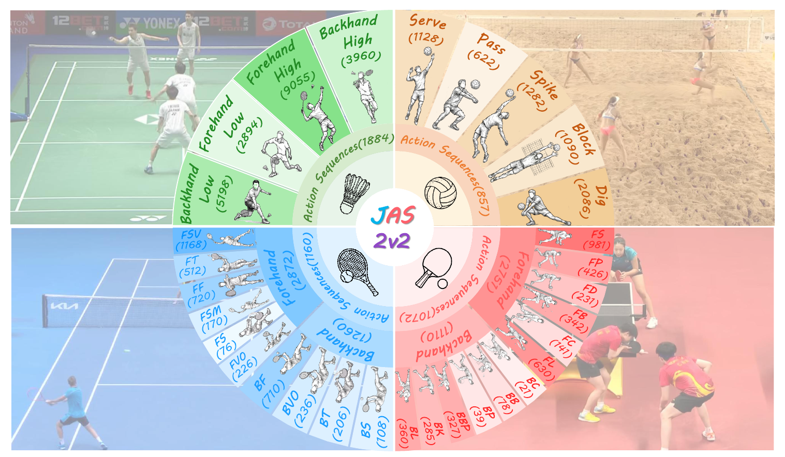
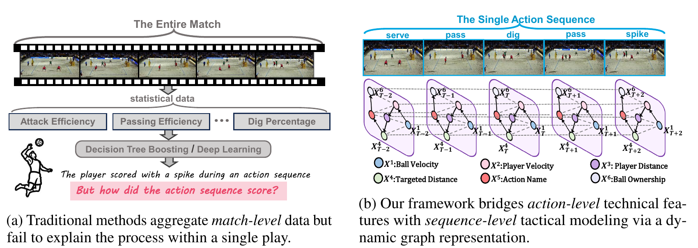
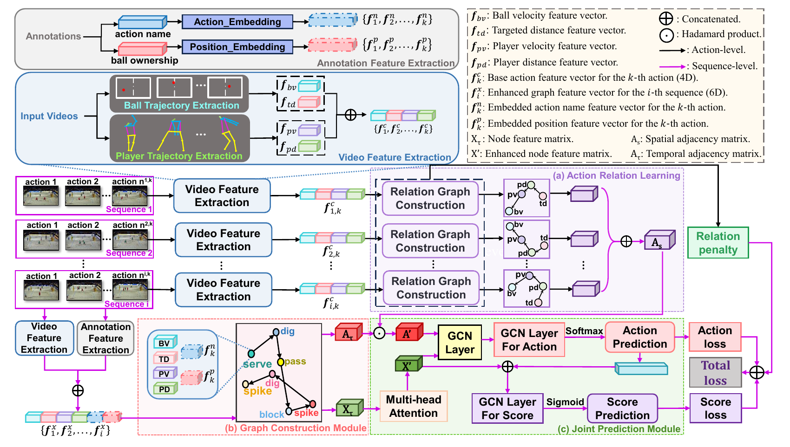

<div align="center">

# JAS-2v2

### Beyond Score: A Dataset for Joint Action and Score Predictions in 2v2 Sports

**NeurIPS 2026 · Evaluations and Datasets**

Yuting Wang · Peng Wen · Fengshun Wang · Jiayong Zuo · Xinyu Peng · Qiurui Wang

[Dataset](https://drive.google.com/drive/folders/1o991foYFWqHUBbjFVtOQV_VapdC6MZQy) · [Annotations](data) · [Splits](splits) · [Getting Started](#getting-started) · [Citation](#citation)

</div>

## Overview

**JAS-2v2** is a multi-sport dataset and benchmark for **joint action prediction and score outcome prediction**. It brings together **beach volleyball, badminton doubles, tennis doubles, and table tennis doubles** within a shared action-sequence modeling framework.

The benchmark focuses on the development of individual rallies: the actions performed, their temporal organization, and their predictive relationships with the final rally outcome. It supports research on action-level representations, structured relational modeling, and multi-sport sports analysis.

<p align="center">
  
</p>

## Dataset Download

**Videos and their corresponding CSV annotations are available on Google Drive:**

### [Download JAS-2v2 — Google Drive](https://drive.google.com/drive/folders/1o991foYFWqHUBbjFVtOQV_VapdC6MZQy)

The Google Drive folder contains four sport-specific directories:

```text
JAS_2v2/
├── badminton/
├── beach_volleyball/
├── table_tennis/
└── tennis/
```

Keep the videos and their corresponding CSV annotations together when preparing the data.

This GitHub repository provides annotation CSVs, split lists, metadata, and reference code. Videos and their corresponding annotations are hosted separately on Google Drive.

## From Actions to Outcomes

JAS-2v2 uses a complete rally, from serve to point completion, as the sequence-level unit. Action annotations connect physical motion, action semantics, acting-player positions, and rally outcomes.

<p align="center">
  
</p>

*From aggregate match statistics to action-level sequence modeling.*

The benchmark includes two tasks:

1. **Action category prediction:** predict the current action category using preceding action context.
2. **Score outcome prediction:** classify whether the serving team wins or loses the rally.

The complete-rally score setting is retrospective outcome classification. The paper also evaluates score prediction from partially observed rallies.

Beach volleyball includes multi-contact teammate exchanges, while the three racket sports involve direct exchanges across opposing sides. JAS-2v2 preserves sport-specific action definitions within a common sequence-modeling setting.

## Dataset Statistics

The paper reports the following match-level train/test allocation:

| Sport | Matches, train/test | Sequences, train/test | Actions, train/test | Classes |
|---|---:|---:|---:|---:|
| Beach volleyball | 9 / 3 | 1,413 / 471 | 4,656 / 1,552 | 5 |
| Badminton doubles | 11 / 4 | 628 / 229 | 15,478 / 5,629 | 14 |
| Tennis doubles | 6 / 2 | 804 / 268 | 3,099 / 1,033 | 10 |
| Table tennis doubles | 9 / 3 | 870 / 290 | 2,896 / 965 | 12 |
| **Total** | **35 / 12** | **3,715 / 1,258** | **26,129 / 9,179** | **41** |

Annotations include:

- **Action boundaries:** temporal start and end of each action.
- **Action categories:** sport-specific technical action labels.
- **Acting-player positions:** court-position identifiers for the player executing an action.
- **Rally outcomes:** binary win/loss labels for the serving team.

Sport-specific action taxonomies and annotation guidelines are described in the paper.

## Reference Framework

The paper introduces a joint action-to-score framework with three modules:

- **Action Relation Learning (ARL):** learns predictive relations among action steps from their physical features.
- **Graph Construction:** combines physical descriptors and semantic cues in an action-graph representation.
- **Joint Prediction:** predicts action categories and uses inferred action representations for sequence-level outcome prediction.

<p align="center">
  
</p>

*The unified action-to-score framework. Learned graph relations are interpreted as predictive dependencies.*

### Physical descriptors

| Descriptor | Meaning |
|---|---|
| **BV — Ball Velocity** | Average ball speed within an action segment |
| **PV — Player Velocity** | Average motion speed of the acting player within an action segment |
| **TD — Target Distance** | Distance between the estimated ball landing point and the position of the subsequent action executor |
| **PD — Player Distance** | Start-to-end displacement of the acting player within an action segment |

Reconstructing these descriptors requires aligned videos and annotations, together with ball detection and player pose estimation.

TD uses information about the subsequent action executor. Its availability must be considered explicitly when evaluating online or partial-observation prediction.

## Repository Structure

```text
.
├── README.md
├── LICENSE.txt
├── metadata.json
├── requirements.txt
├── assets/
│   └── figures/
│       ├── dataset_overview.png
│       ├── action_to_score.png
│       └── framework.png
├── code/
│   ├── dataset.py
│   ├── models.py
│   ├── train_multitask_gcn.py
│   ├── train_action_to_score.py
│   └── extract_action_features.py
├── data/
│   ├── badminton/
│   ├── beachvolleyball/
│   ├── tennis/
│   └── table_tennis/
└── splits/
    ├── train_files.txt
    └── test_files.txt
```

## Getting Started

### 1. Clone the repository

```bash
git clone https://github.com/AngeIine/JAS_2v2.git
cd JAS_2v2
```

### 2. Install dependencies

```bash
python -m pip install -r requirements.txt
```

For CUDA acceleration, install a PyTorch build compatible with your hardware.

### 3. Download the videos and annotations

Download the required sport folders from
[Google Drive](https://drive.google.com/drive/folders/1o991foYFWqHUBbjFVtOQV_VapdC6MZQy).

Retain the correspondence between videos and CSV annotations, and configure local paths for the selected preprocessing or training script.

### 4. Explore the annotation format

CSV annotations are also provided under [`data/`](data). The release retains sport-specific column conventions:

| Content | Field names |
|---|---|
| Action category | `action_name` or `name` |
| Acting-player position | `position` |
| Binary rally outcome | `score` |
| Action boundaries | `start_frame` / `end_frame`, or timestamp-style `start` / `end` |

Processed feature files may additionally contain:

```text
target_distance, pdistance, pspeed, bspeed
```

Check the available columns before selecting a feature configuration. Timestamp-based annotations require frame alignment when reconstructing video-derived features.

The release split lists are available under [`splits/`](splits). Check the split logic of the selected training script when reproducing a particular experiment.

### 5. Run the lightweight training scaffold

Run from the repository root:

```bash
python code/train_multitask_gcn.py --data-root data --split-mode mixed --feature-tier common
```

This provides a lightweight entry point for the released annotation pipeline. Its defaults differ from the full paper experiment configuration, and its split is constructed by the script rather than automatically loaded from `splits/`.

Inspect available options with:

```bash
python code/train_multitask_gcn.py --help
python code/train_action_to_score.py --help
```

The joint action-to-score implementation expects suitable processed physical-feature CSVs. For video-based feature extraction, see [`code/extract_action_features.py`](code/extract_action_features.py).

## Paper-Reported Results

Selected results on the unified four-sport benchmark, in percent:

| Method | Action Accuracy | Action F1 | Score Accuracy | Score F1 |
|---|---:|---:|---:|---:|
| Graphormer | 72.64 | 71.02 | 85.20 | 83.61 |
| Mamba | 73.35 | 71.90 | 86.42 | 84.85 |
| **Ours** | **74.28** | **72.91** | **87.45** | **86.13** |

These values are reported in the paper under its full-feature evaluation setting. The paper additionally includes feature and module ablations, temporal permutation tests, partial-rally evaluation, and leave-one-sport-out experiments.

## Citation

If you use JAS-2v2 in your research, please cite:

```bibtex
@inproceedings{wang2026beyondscore,
  title     = {Beyond Score: A Dataset for Joint Action and Score Predictions in 2v2 Sports},
  author    = {Wang, Yuting and Wen, Peng and Wang, Fengshun and Zuo, Jiayong and Peng, Xinyu and Wang, Qiurui},
  booktitle = {Advances in Neural Information Processing Systems},
  year      = {2026}
}
```

## Usage Terms

Please read [`LICENSE.txt`](LICENSE.txt) for the annotation release notice and usage terms.

Original broadcast footage remains subject to its owners' rights and applicable platform terms. Access through the Google Drive folder does not change those underlying rights.

## Contact

- **Yuting Wang:** [wangyuting2023@cupes.edu.cn](mailto:wangyuting2023@cupes.edu.cn)
- **Qiurui Wang (corresponding author):** [wangqiurui@cupes.edu.cn](mailto:wangqiurui@cupes.edu.cn)

For questions about annotations or code, please [open an issue](https://github.com/AngeIine/JAS_2v2/issues).
